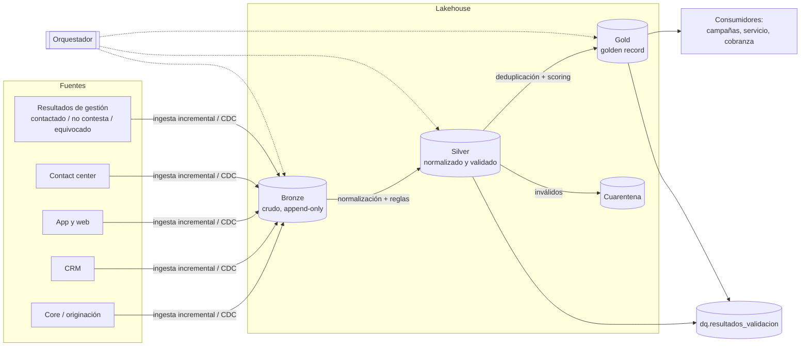
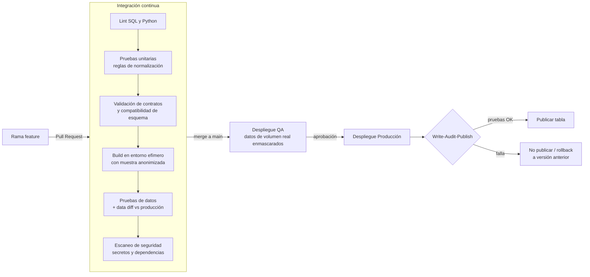

# Ejercicio 1 — Dataset confiable de teléfonos de clientes con CI/CD

## 1. Objetivo y alcance

Construir y mantener, de forma automatizada, un dataset con **el mejor teléfono de contacto de cada cliente** (y su historial), apto para comunicación y servicio al cliente, con controles de calidad en cada etapa y despliegue gobernado por CI/CD.

**Entregable de datos (capa Gold):**

| Tabla | Grano | Uso |
|---|---|---|
| `gold.cliente_telefono` | cliente × teléfono | Todos los teléfonos válidos con su puntaje, tipo, fuente, vigencia (SCD tipo 2) |
| `gold.cliente_telefono_principal` | cliente | Teléfono principal móvil y fijo listos para contactar |
| `dq.resultados_validacion` | regla × ejecución | Insumo de la veeduría de calidad (ejercicio 2) |

## 2. Arquitectura



La solución es agnóstica de proveedor: el mismo diseño aplica en AWS (S3 + Glue/EMR + Athena), Azure (ADLS + Databricks/Synapse) o GCP (GCS + BigQuery), orquestado con Airflow y transformado con dbt o Spark.

### Bronze — ingesta
- Extracción incremental por marca de agua o CDC; se conserva el dato tal como llega (`telefono_raw`), con `fuente`, `fecha_captura`, `id_lote` y `hash_registro`.
- Append-only: permite reprocesar y auditar cualquier versión.
- Validaciones de **contrato** (esquema, tipos, columnas obligatorias). Si el contrato falla, el lote se rechaza y no avanza.

### Silver — normalización y validación
Implementación de referencia en [`src/normalizador_telefono.py`](src/normalizador_telefono.py) (con pruebas en `tests/`):

| # | Regla | Resultado |
|---|---|---|
| S1 | Quitar espacios, guiones, paréntesis, puntos, extensiones | — |
| S2 | Quitar prefijos de país `+57` / `0057` y de larga distancia antigua (`0`, `03`, `05`, `07`, `09`) | — |
| S3 | Móvil: 10 dígitos iniciando en `3` | `VALIDO` |
| S4 | Fijo: 10 dígitos `60X…` (plan de numeración vigente desde 2021) | `VALIDO` |
| S5 | Fijo antiguo (indicativo + 7 dígitos) → se migra a `60` + indicativo + 7 | `CORREGIDO` |
| S6 | Fijo de 7 dígitos: se completa con el indicativo de la ciudad del cliente; si no se conoce | `INVALIDO` |
| S7 | Patrones de relleno (`3000000000`, dígitos repetidos, secuencias) | `SOSPECHOSO` |
| S8 | Formato E.164 (`+57…`) como llave técnica del teléfono | — |
| S9 | Cliente inexistente en el maestro de clientes | Cuarentena |

Los registros `INVALIDO` / `SOSPECHOSO` no se pierden: van a cuarentena con su motivo, para retroalimentar a las fuentes.

### Gold — golden record
1. **Deduplicación** por (`id_cliente`, `telefono_e164`) consolidando fuentes, primera y última fecha vista.
2. **Puntaje de confiabilidad** por teléfono, por ejemplo:

   `score = 0.35·efectividad_contacto + 0.25·recencia + 0.20·confiabilidad_fuente + 0.10·frecuencia_en_fuentes + 0.10·autorizacion_vigente`

   - *efectividad_contacto*: tasa de contactos exitosos de los últimos 6 meses (penaliza "número equivocado").
   - *recencia*: decae con los días desde la última actualización.
   - *confiabilidad_fuente*: catálogo parametrizable (p. ej. app con OTP verificado > CRM > originación antigua).
3. **Teléfono principal**: el de mayor puntaje por tipo; desempate por fecha de actualización más reciente.
4. **Historial SCD tipo 2** (`vigente_desde`, `vigente_hasta`, `es_vigente`) para trazabilidad.
5. **Un teléfono compartido por muchos clientes** (más de N) se marca como sospechoso: suele ser un número de oficina, de un asesor o fraude.

### Gobierno, seguridad y cumplimiento
- Datos personales sujetos a la Ley 1581 de 2012 (Habeas Data) y su reglamentación: se publica solo lo autorizado, con indicador de autorización y canales permitidos; los opt-out se aplican en Gold antes de exponer el dato.
- El uso para gestión de cobro y comercial debe respetar la regulación vigente sobre canales y horarios de contacto (p. ej. Ley 2300 de 2023); el dataset expone banderas para que los consumidores filtren.
- Teléfono enmascarado para perfiles sin necesidad de conocerlo (`315*****61`); acceso por roles; cifrado en reposo y en tránsito; secretos en un gestor de secretos, nunca en el repositorio.

## 3. CI/CD



**Integración continua (en cada Pull Request)**
- Linters (`sqlfluff`, `ruff`) y revisión de código obligatoria.
- Pruebas unitarias de las reglas (como `tests/test_normalizador.py`).
- Validación de los contratos de datos: un cambio que rompe el esquema publicado exige versión mayor.
- Construcción del pipeline completo en un entorno efímero con una muestra anonimizada, y ejecución de las pruebas de datos (unicidad, no nulos, valores aceptados, integridad referencial, rangos de volumen).
- *Data diff* contra producción: cuántos clientes cambian de teléfono principal con el cambio propuesto. Una variación atípica bloquea el merge hasta revisión.

**Despliegue continuo**
- Infraestructura como código (Terraform) y artefactos versionados (imagen del job, paquete dbt).
- Promoción `dev → qa → prod` con aprobación manual hacia producción.
- **Write-Audit-Publish**: cada ejecución escribe en una tabla temporal, se auditan las reglas críticas y solo entonces se intercambia con la tabla publicada. Si falla, los consumidores siguen leyendo la versión anterior.
- Rollback por versión de tabla (Delta/Iceberg *time travel*) o redepliegue del tag anterior.

Ejemplo de workflow (GitHub Actions):

```yaml
name: telefonos-ci
on:
  pull_request:
    paths: ["telefonos/**"]
jobs:
  ci:
    runs-on: ubuntu-latest
    steps:
      - uses: actions/checkout@v4
      - uses: actions/setup-python@v5
        with: { python-version: "3.12" }
      - run: pip install -r requirements-dev.txt
      - run: ruff check . && sqlfluff lint models/
      - run: python -m unittest discover -s tests
      - run: dbt build --target ci --select state:modified+ --defer --state prod-manifest/
      - run: python scripts/data_diff.py --max-cambio-principal 0.02
```

## 4. Operación y mantenimiento

| Aspecto | Práctica |
|---|---|
| Orquestación | DAG diario (o por evento CDC) con dependencias Bronze → Silver → Gold → DQ; reintentos e idempotencia por `id_lote`. |
| SLA | Gold disponible antes de la hora acordada con negocio (p. ej. 6:00 a. m.); alerta si se incumple. |
| Monitoreo | Volumen por fuente, % válidos, % sospechosos, cambios de teléfono principal, frescura. Alertas a Teams/Slack/correo. |
| Retroalimentación | Resultados de gestión (contactado / equivocado) actualizan el puntaje: el dataset mejora con el uso. |
| Calidad en la fuente | Reportes periódicos de cuarentena por fuente y canal de captura para corregir en origen (validación en formularios, OTP). |
| Documentación | Catálogo de datos con definición de columnas, dueño, contrato y linaje (ver ejercicio 2). |

## 5. Contrato de datos (extracto)

```yaml
dataset: gold.cliente_telefono_principal
owner: ingenieria-datos
version: 1.0.0
sla: { frescura_max_horas: 24 }
columns:
  - { name: id_cliente,        type: string,    required: true, unique: true }
  - { name: telefono_movil,    type: string,    pattern: '^\+573\d{9}$' }
  - { name: telefono_fijo,     type: string,    pattern: '^\+5760[1-8]\d{7}$' }
  - { name: score_movil,       type: decimal,   range: [0, 1] }
  - { name: autoriza_contacto, type: boolean,   required: true }
  - { name: fecha_actualizacion, type: timestamp, required: true }
quality:
  - "pct_clientes_con_movil >= 0.85"
  - "pct_telefonos_sospechosos <= 0.02"
```
