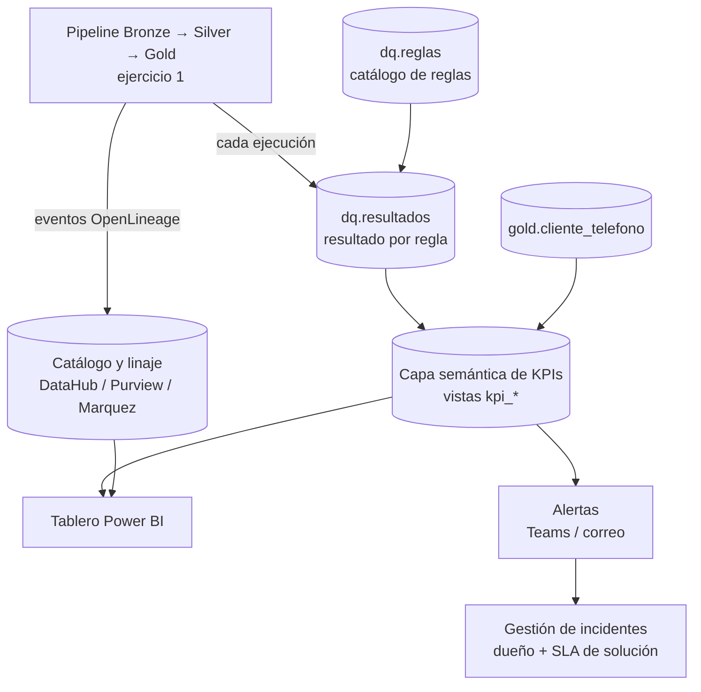

# Ejercicio 2 — Veeduría de calidad, trazabilidad y KPIs de teléfonos

## 1. Propuesta: Observatorio de Calidad de Teléfonos

Un mecanismo con cinco piezas que se alimenta automáticamente del pipeline del ejercicio 1, para que negocio consulte KPIs sin depender de ingeniería:



| Pieza | Qué resuelve |
|---|---|
| **Catálogo de reglas** (`dq.reglas`) | Cada regla tiene dimensión, umbral, severidad y dueño. Negocio puede proponer reglas y umbrales sin tocar código. |
| **Resultados por ejecución** (`dq.resultados`) | Historial de cada regla en cada corrida: base de tendencias y auditoría. |
| **Linaje y trazabilidad** | A nivel de tabla y columna (`telefono_raw → telefono_e164 → telefono_principal`) desde el orquestador, y a nivel de registro: cada fila Gold conserva `fuente`, `id_lote`, `fecha_captura` y `hash_registro`, para responder "¿de dónde salió este teléfono y cuándo cambió?". |
| **Capa semántica de KPIs** | Vistas con definiciones únicas y versionadas, para que todos los equipos calculen igual. |
| **Tablero + alertas** | Consumo de autoservicio y aviso proactivo cuando un KPI cruza su umbral. |

## 2. Modelo de datos de la veeduría

```sql
CREATE TABLE dq.reglas (
    id_regla        VARCHAR(20) PRIMARY KEY,      -- p. ej. 'TEL_VAL_01'
    dataset         VARCHAR(100) NOT NULL,
    dimension       VARCHAR(20)  NOT NULL,        -- COMPLETITUD | VALIDEZ | UNICIDAD | OPORTUNIDAD | CONSISTENCIA | EXACTITUD
    descripcion     VARCHAR(500) NOT NULL,
    severidad       VARCHAR(10)  NOT NULL,        -- CRITICA (bloquea publicación) | ALTA | MEDIA
    umbral_minimo   DECIMAL(5,4) NOT NULL,        -- % de cumplimiento esperado
    dueno           VARCHAR(100) NOT NULL,
    vigente         BOOLEAN      NOT NULL DEFAULT TRUE
);

CREATE TABLE dq.resultados (
    id_ejecucion    VARCHAR(40)  NOT NULL,
    id_regla        VARCHAR(20)  NOT NULL REFERENCES dq.reglas,
    fecha_ejecucion TIMESTAMP    NOT NULL,
    fuente          VARCHAR(50),                  -- permite abrir el KPI por fuente
    filas_evaluadas BIGINT       NOT NULL,
    filas_fallidas  BIGINT       NOT NULL,
    pct_cumplimiento DECIMAL(5,4) GENERATED ALWAYS AS (1 - filas_fallidas::DECIMAL / NULLIF(filas_evaluadas, 0)),
    estado          VARCHAR(10)  NOT NULL,        -- OK | ALERTA | FALLA
    muestra_fallas  JSON,                         -- hasta 20 ejemplos enmascarados para diagnóstico
    PRIMARY KEY (id_ejecucion, id_regla, fuente)
);
```

## 3. Catálogo de KPIs

### Calidad del dato

| KPI | Fórmula | Meta sugerida |
|---|---|---|
| Cobertura de móvil | clientes activos con móvil principal válido / clientes activos | ≥ 85 % |
| Cobertura de algún teléfono | clientes con al menos un teléfono utilizable / clientes activos | ≥ 95 % |
| Tasa de validez | teléfonos `VALIDO` + `CORREGIDO` / teléfonos recibidos | ≥ 90 % |
| Tasa de sospechosos | teléfonos `SOSPECHOSO` / teléfonos recibidos | ≤ 2 % |
| Unicidad | teléfonos compartidos por más de N clientes / teléfonos únicos | ≤ 0,5 % |
| Frescura | % de teléfonos principales actualizados en los últimos 12 meses | ≥ 70 % |
| Oportunidad (SLA) | ejecuciones publicadas antes de la hora acordada / ejecuciones | ≥ 99 % |
| Índice de calidad compuesto | promedio ponderado del cumplimiento de reglas por dimensión | ≥ 95 % |

### Efectividad para negocio

| KPI | Fórmula |
|---|---|
| Contactabilidad | gestiones con contacto efectivo / gestiones realizadas al teléfono principal |
| Tasa de número equivocado | gestiones "no corresponde al cliente" / gestiones realizadas |
| Clientes contactables y autorizados | clientes con teléfono utilizable **y** autorización vigente / clientes activos |
| Estabilidad del principal | % de clientes cuyo teléfono principal cambió en el mes (picos indican problemas de fuente) |
| Calidad por fuente | tasa de validez y de número equivocado por fuente de captura |

Ejemplo de vista de KPI:

```sql
CREATE VIEW kpi.cobertura_telefonos AS
SELECT
    c.fecha_corte,
    COUNT(*)                                                         AS clientes_activos,
    AVG(CASE WHEN p.telefono_movil IS NOT NULL THEN 1.0 ELSE 0 END)  AS cobertura_movil,
    AVG(CASE WHEN p.telefono_movil IS NOT NULL
               OR p.telefono_fijo IS NOT NULL THEN 1.0 ELSE 0 END)   AS cobertura_algun_telefono,
    AVG(CASE WHEN p.autoriza_contacto
              AND (p.telefono_movil IS NOT NULL OR p.telefono_fijo IS NOT NULL)
             THEN 1.0 ELSE 0 END)                                    AS contactables_autorizados
FROM gold.clientes_activos AS c
LEFT JOIN gold.cliente_telefono_principal AS p
       ON p.id_cliente = c.id_cliente
GROUP BY c.fecha_corte;
```

## 4. Tablero (Power BI)

| Página | Contenido | Usuario principal |
|---|---|---|
| Resumen ejecutivo | Tarjetas de cobertura, contactabilidad, índice de calidad, semáforo vs. meta y tendencia de 12 meses | Gerencias |
| Calidad por dimensión | Cumplimiento por regla y dimensión, top de reglas que fallan, muestras enmascaradas | Gobierno de datos |
| Fuentes | Validez, sospechosos y número equivocado por fuente y canal de captura | Dueños de fuentes |
| Trazabilidad | Búsqueda por cliente: historial SCD2 de teléfonos, fuente, lote y fecha de cada cambio; diagrama de linaje | Servicio al cliente, auditoría |
| Operación | Frescura, duración y estado de las ejecuciones, cumplimiento de SLA | Ingeniería de datos |

Seguridad a nivel de fila y de columna: la página de trazabilidad muestra el teléfono enmascarado salvo para roles autorizados.

## 5. Alertas y gestión

- **Regla crítica falla** → el pipeline no publica (Write-Audit-Publish) y se notifica al dueño.
- **KPI fuera de umbral** o **desviación atípica** (más de 3 desviaciones estándar frente a las últimas 8 ejecuciones) → alerta a Teams/correo con enlace al tablero filtrado.
- Cada alerta genera un incidente con dueño, prioridad según severidad y SLA de solución; el tablero muestra incidentes abiertos y tiempo medio de resolución.
- Comité mensual de calidad con negocio para revisar tendencias y ajustar reglas y metas.
