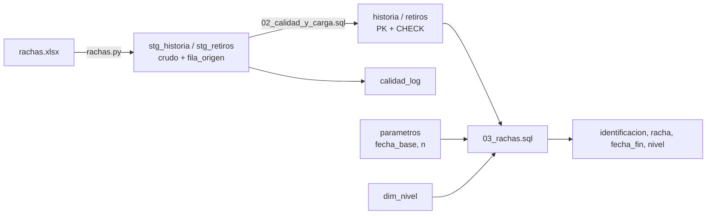

# Ejercicio 3 — Rachas de nivel de deuda

Motor: **SQLite** (incluido en Python, sin instalación adicional). La consulta usa CTE recursivas y funciones de ventana estándar, por lo que se traslada a PostgreSQL / Impala cambiando solo las funciones de fecha.

## Estructura

```
ejercicio_3_rachas/
├── data/rachas.xlsx              # Fuente entregada
├── sql/
│   ├── 01_esquema.sql            # Tablas staging, depuradas, catálogo de niveles, parámetros, bitácora
│   ├── 02_calidad_y_carga.sql    # Reglas de calidad + carga de historia y retiros
│   └── 03_rachas.sql             # Consulta solución (lee fecha_base y n de la tabla parametros)
├── rachas.py                     # Orquestador: Excel -> SQLite -> calidad -> consulta -> CSV
├── tests/test_rachas.py          # Casos dirigidos + contraste contra implementación de referencia
└── output/                       # Resultados de ejemplo
```

## Cómo replicarlo

```bash
pip install openpyxl                       # solo para leer el .xlsx
cd ejercicio_3_rachas
python rachas.py --fecha-base 2024-12-31 --n 3 --salida output/rachas.csv
python rachas.py --solo-consulta --fecha-base 2024-06-15 --n 4     # reutiliza la BD ya construida
python -m unittest discover -s tests -v
```

Desde cualquier cliente SQL, sobre `output/rachas.db`:

```sql
UPDATE parametros SET fecha_base = '2024-06-15', n = 4 WHERE id = 1;
-- ejecutar sql/03_rachas.sql
```

## Flujo de datos



## Lógica de la consulta (`03_rachas.sql`)

| CTE | Qué hace |
|---|---|
| `params` | Lee `fecha_base` y `n`. |
| `historia_vigente` | Solo cortes `<= fecha_base` (se "para" en esa fecha). |
| `limites` / `calendario` | Genera todos los fines de mes desde el primer corte hasta el último evaluable. |
| `clientes` | Primer corte de cada cliente y su fecha de retiro. |
| `saldos_mes` | Grilla continua cliente × mes desde su primera aparición; meses sin reporte → saldo 0 (N0); se excluyen los cortes posteriores a la fecha de retiro. |
| `niveles` | Asigna nivel uniéndose con `dim_nivel` (rangos semiabiertos `[min, max)`). |
| `islas` | *Gaps & islands*: `índice_mes − ROW_NUMBER() OVER (PARTITION BY cliente, nivel)` es constante dentro de una racha. |
| `rachas` | Longitud, inicio y fin de cada racha. |
| `rachas_ranking` | Filtra `racha >= n` y ordena por racha DESC, fecha_fin DESC; se toma la primera. |

## Supuestos

1. Solo se usa información con `corte_mes <= fecha_base`; un cliente cuyo primer corte es posterior a la fecha base no existe todavía.
2. El último mes evaluable es el menor entre el último fin de mes `<= fecha_base` y el último corte cargado. Así, una fecha base futura (ej. 2026-10-24) no genera meses N0 que no se han reportado para nadie.
3. "Corte superior a la fecha de retiro" se aplica a meses imputados **y** reportados: se considera que el cliente ya no está en cartera. Un retiro posterior a la fecha base no tiene efecto (aún no ha ocurrido).
4. Los niveles viven en `dim_nivel` para poder cambiar umbrales sin tocar la consulta.

## Calidad de datos encontrada

| Regla | Hallazgo | Tratamiento |
|---|---|---|
| H6 duplicado exacto | `9NWFWJ38XN31WBFXG` 2023-08-31 aparece 2 veces con el mismo saldo | Se conserva uno |
| H7 llave con saldos distintos | `R7Q4Z9AULIORDJQ9D` 2024-12-31 con 571.481 y 1.142.962 (el segundo es exactamente el doble) | Se conserva el mayor (criterio conservador de riesgo) y se alerta |
| R3 / R3b / R4 retiro sin historia | `1LFTDYT2H0I9ZGED3S8` tiene 19 caracteres (el resto 17) y no existe en historia; es casi idéntico a `1LFTDYT2H0I9ZG3S8` | No se corrige automáticamente: se deja la alerta con el candidato para validación con negocio |
| R5 saldos posteriores al retiro | `0TTW5R9RRCJ0A9E5F` (3 cortes) y `THJ9OBJH3W6ANRCMS` (11 cortes) reportan saldo después de retirarse | La consulta los excluye por regla de negocio |

Verificaciones sin hallazgos: nulos, saldos negativos, fechas que no son fin de mes, identificaciones con espacios/minúsculas. Todas quedan implementadas y se registran en `calidad_log` si aparecen en futuras cargas.

## Validación

`tests/test_rachas.py` contiene:

- 9 casos sintéticos: imputación N0, límites exactos de nivel, desempates, retiro, retiro futuro, fecha base a mitad de mes, filtro `n` y reglas de calidad.
- Un contraste de la consulta SQL contra una implementación iterativa independiente en Python, sobre los datos reales, para 7 fechas base × 5 valores de `n` (35 combinaciones). Todas coinciden.

Resultados de ejemplo en `output/` (p. ej. `fecha_base=2024-12-31, n=3` → 91 clientes).
