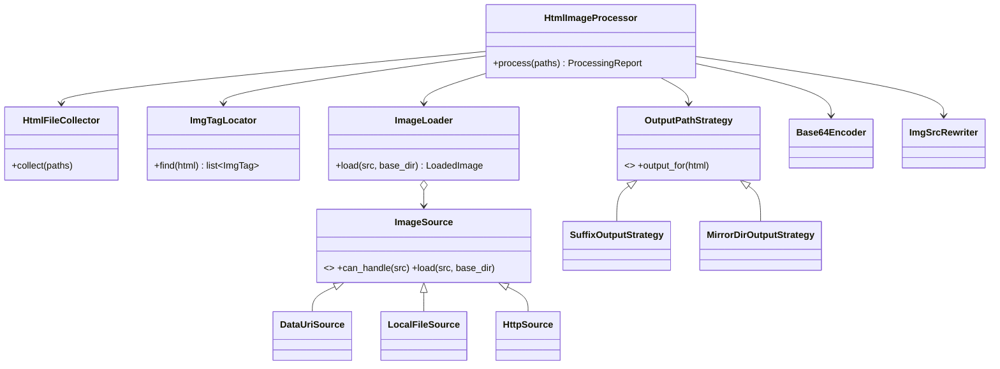

# Ejercicio 4 — Procesamiento de archivos HTML (imágenes a base64)

Solo librería estándar de Python (≥ 3.9). Sin dependencias.

## Uso

```bash
cd ejercicio_4_html_base64

# Uno o varios directorios (recursivo) y/o archivos sueltos
python -m html_base64 examples/sitio
python -m html_base64 examples/sitio/index.html otra/pagina.htm

# Opciones
python -m html_base64 examples/sitio --output-dir salida   # replica estructura en otra carpeta
python -m html_base64 examples/sitio --suffix _embebido     # pagina_embebido.html
python -m html_base64 examples/sitio --allow-remote         # también descarga http(s)
python -m html_base64 examples/sitio --report reporte.json -v

python -m unittest discover -s tests -v
```

Uso programático:

```python
from html_base64 import build_processor

rutas = ["examples/sitio"]
reporte = build_processor(rutas).process(rutas)
reporte.to_dict()
```

Por defecto, `pagina.html` genera `pagina_base64.html` junto al original (el original nunca se modifica). El código de salida es `1` si alguna imagen falló, útil en pipelines.

## Objeto de resultado

```json
{
  "success": {
    "/ruta/sitio/index.html": [
      {"src": "img/logo%20tuya.png", "mime_type": "image/png", "size_bytes": 88}
    ]
  },
  "fail": {
    "/ruta/sitio/index.html": [
      {"src": "img/no_existe.jpg", "error": "archivo no encontrado: ..."},
      {"src": "img/no_es_imagen.png", "error": "el contenido no coincide con el formato image/png"},
      {"src": null, "error": "etiqueta  sin atributo src"}
    ]
  },
  "outputs": {"/ruta/sitio/index.html": "/ruta/sitio/index_base64.html"}
}
```

`success` y `fail` se agrupan por archivo HTML; `outputs` (adicional) indica el archivo generado.

## Diseño



| Módulo | Responsabilidad |
|---|---|
| `discovery.py` | Expande archivos y directorios (recursivo), deduplica, excluye salidas previas. |
| `html_rewriter.py` | Ubica `` con `html.parser` (ignora comentarios y `<script>`), codifica a data URI y reemplaza solo el atributo `src`. |
| `sources.py` | Fuentes de imagen intercambiables + detección de MIME por firma binaria. |
| `processor.py` | Orquestación, estrategias de nombre de salida y fábrica `build_processor`. |
| `models.py` | `ImgTag`, `LoadedImage`, `ProcessingReport`, `ImageProcessingError`. |
| `cli.py` | Argumentos, reporte JSON y código de salida. |

Principios aplicados:

- **S**: cada clase tiene una sola razón de cambio (descubrir, ubicar, cargar, codificar, reescribir, nombrar).
- **O**: nuevas fuentes (S3, FTP) o estrategias de salida se agregan con nuevas clases, sin tocar el procesador.
- **L / I**: `ImageSource` y `OutputPathStrategy` son interfaces mínimas e intercambiables.
- **D**: `HtmlImageProcessor` recibe sus colaboradores por constructor; `build_processor` arma la configuración por defecto. Esto facilita las pruebas.

## Decisiones y casos borde

- **Reemplazo no destructivo del documento**: solo cambia el texto de cada etiqueta ``; el resto del HTML queda byte a byte igual (se lee y escribe con `surrogateescape` para no romper archivos que no son UTF-8 válido).
- `src` con comillas dobles, simples o sin comillas, en mayúsculas, rutas URL-encoded (`%20`), relativas al HTML, absolutas o `file://`.
- No confunde `data-src` con `src`.
- El tipo MIME se detecta por la **firma del contenido**; un `.png` que en realidad es texto se reporta como fallo.
- Imágenes ya embebidas (`data:...;base64`) se validan y se reportan como exitosas sin modificarlas.
- Las imágenes remotas están deshabilitadas por defecto (seguridad y reproducibilidad); se activan con `--allow-remote`, con timeout y límite de tamaño.
- Caché por ejecución: una imagen usada por varias etiquetas se lee una sola vez.
- Al recorrer directorios se excluyen los `*_base64.html` generados previamente (o la carpeta `--output-dir`), así el proceso es idempotente.
- Un archivo sin imágenes igualmente genera su copia, para que la salida sea predecible.
